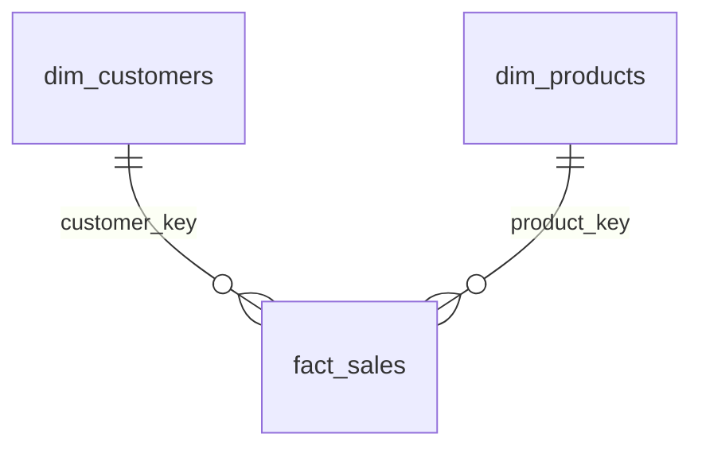

# Gold Layer Data Catalog

Customers, products and sales: the business-ready views of the warehouse.

*Shanto Islam | SQL Server | Last updated November 2026*

---

## What this is

The gold layer is the part of the warehouse people actually query. Everything in it is built on top of the cleaned silver tables and shaped as a **star schema**: two dimensions (customers and products) and one fact (sales).

All three are plain SQL Server **views**, so there is nothing to load or refresh. They always show whatever is in silver right now. This catalog covers what each view is for, where every column comes from, and the quirks worth knowing before you build a report on top.

| View | Kind | One row per | Built from |
|---|---|---|---|
| `gold.dim_customers` | Dimension | customer | `silver.crm_cust_info`, `silver.erp_cust_az12`, `silver.erp_loc_a101` |
| `gold.dim_products` | Dimension | current product | `silver.crm_prd_info`, `silver.erp_px_cat_g1v2` |
| `gold.fact_sales` | Fact | order line | `silver.crm_sales_details`, plus the two dimensions above |



Dimensions describe things, the fact table records what happened. They meet on surrogate keys.

---

## 1. gold.dim_customers

**Who bought.** One row per customer, putting the CRM record together with the ERP birthdate and country.

| Column Name | Data Type | Comes from | Description |
|---|---|---|---|
| `customer_key` | BIGINT | generated (`ROW_NUMBER`) | Surrogate key. This is what `fact_sales` joins to. |
| `customer_id` | INT | `crm_cust_info.cst_id` | Numeric customer ID from the CRM system. |
| `customer_number` | NVARCHAR(50) | `crm_cust_info.cst_key` | Alphanumeric customer code such as `AW00011000`. After silver cleaning, the ERP tables use the same code. |
| `first_name` | NVARCHAR(50) | `crm_cust_info.cst_firstname` | First name, trimmed. |
| `last_name` | NVARCHAR(50) | `crm_cust_info.cst_lastname` | Last name, trimmed. |
| `country` | NVARCHAR(50) | `erp_loc_a101.cntry` | Full country name, for example Germany or United States. `'n/a'` if the source was blank. |
| `marital_status` | NVARCHAR(50) | `crm_cust_info.cst_marital_status` | Single, Married or `'n/a'`. |
| `gender` | NVARCHAR(50) | `crm_cust_info.cst_gndr`, then `erp_cust_az12.gen` | Male, Female or `'n/a'`. CRM wins; ERP only fills the gaps. |
| `birthdate` | DATE | `erp_cust_az12.bdate` | Date of birth. NULL when unknown or invalid. |
| `create_date` | DATE | `crm_cust_info.cst_create_date` | Date the customer record was created in the CRM. |

**Good to know**

- CRM is the master for gender. ERP is only used when CRM says `'n/a'`, and if neither system knows, the value stays `'n/a'`.
- Birthdates in the future were blanked out in silver, so `birthdate` can be NULL. Dates before 1924 are kept as they came, but they are worth a second look.
- It is a left join from CRM. A customer with no ERP match still shows up, just with NULL `country` and `birthdate`.

---

## 2. gold.dim_products

**What was sold.** One row per product, current version only, with category details from ERP added on.

| Column Name | Data Type | Comes from | Description |
|---|---|---|---|
| `product_key` | BIGINT | generated (`ROW_NUMBER`) | Surrogate key. This is what `fact_sales` joins to. |
| `product_id` | INT | `crm_prd_info.prd_id` | Numeric product ID from the CRM system. |
| `product_number` | NVARCHAR(50) | `crm_prd_info.prd_key` | Product code such as `FR-R92B-58`, with the category prefix removed. |
| `product_name` | NVARCHAR(50) | `crm_prd_info.prd_nm` | Name including type, colour and size. |
| `category_id` | NVARCHAR(50) | `crm_prd_info.cat_id` | Category code (for example `CO_RF`), taken from the front of the original product key. |
| `category` | NVARCHAR(50) | `erp_px_cat_g1v2.cat` | Top level group, e.g. Bikes or Components. |
| `subcategory` | NVARCHAR(50) | `erp_px_cat_g1v2.subcat` | More specific group inside the category. |
| `maintenance` | NVARCHAR(50) | `erp_px_cat_g1v2.maintenance` | Yes or No: whether the product needs maintenance. |
| `cost` | INT | `crm_prd_info.prd_cost` | Product cost in whole currency units. |
| `product_line` | NVARCHAR(50) | `crm_prd_info.prd_line` | Mountain, Road, Touring, Other Sales or `'n/a'`. |
| `start_date` | DATE | `crm_prd_info.prd_start_dt` | Date this version of the product became active. |

**Good to know**

- Only rows without an end date are included. Each product appears once, at its latest version. Older versions and their history stay in silver.
- A `cost` of 0 means the source had no cost, not that the product is free. Missing costs were replaced with 0 in silver.
- `category`, `subcategory` and `maintenance` are NULL for a product whose category code has no match in the ERP category table.

---

## 3. gold.fact_sales

**What happened.** One row per order line. This is where the numbers live; everything descriptive comes from the two dimensions.

| Column Name | Data Type | Comes from | Description |
|---|---|---|---|
| `order_number` | NVARCHAR(50) | `crm_sales_details.sls_ord_num` | Order identifier such as `SO54496`. One order can have several lines. |
| `product_key` | BIGINT | `gold.dim_products` (matched on `product_number`) | Links the line to its product. |
| `customer_key` | BIGINT | `gold.dim_customers` (matched on `customer_id`) | Links the line to the customer who bought it. |
| `order_date` | DATE | `crm_sales_details.sls_order_dt` | When the order was placed. |
| `shipping_date` | DATE | `crm_sales_details.sls_ship_dt` | When it was shipped. |
| `due_date` | DATE | `crm_sales_details.sls_due_dt` | When payment was due. |
| `sales_amount` | INT | `crm_sales_details.sls_sales` | Total value of the line in whole currency units. |
| `quantity` | INT | `crm_sales_details.sls_quantity` | Units ordered on the line. |
| `price` | INT | `crm_sales_details.sls_price` | Price per unit in whole currency units. |

**Good to know**

- In silver, `sales_amount` was checked against `quantity x price` and recalculated wherever the two disagreed. Missing or non-positive prices were derived from `sales / quantity`.
- Invalid order, ship or due dates became NULL in silver, so the date columns can be empty.
- Both joins are left joins. A sale whose product or customer is not found keeps its row but gets a NULL key. The check query below finds them.

### A note on the surrogate keys

`customer_key` and `product_key` are generated with `ROW_NUMBER()` each time the view is queried. They stay stable while the underlying data does not change, but they can shift after a reload. That is fine for reporting inside the warehouse. Do not copy them into other systems as permanent IDs; use `customer_id` / `product_number` for that.

---

## Two queries to try

A typical report query, and a sanity check to run after every reload.

```sql
-- Total sales by product category
SELECT p.category,
       SUM(f.sales_amount) AS total_sales
FROM gold.fact_sales AS f
JOIN gold.dim_products AS p
    ON p.product_key = f.product_key
GROUP BY p.category
ORDER BY total_sales DESC;
```

```sql
-- Sales lines that did not match a customer or a product
-- Expected result: no rows
SELECT *
FROM gold.fact_sales
WHERE customer_key IS NULL
   OR product_key  IS NULL;
```

---

Column types follow the silver table definitions, except the two generated surrogate keys (BIGINT, from `ROW_NUMBER`). If those change, re-check them with `INFORMATION_SCHEMA.COLUMNS` and update this page.

Dataset and project concept: Data With Baraa SQL Data Warehouse course. The documentation in this file was written for this repository.
